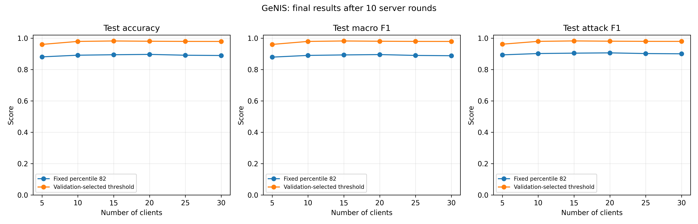
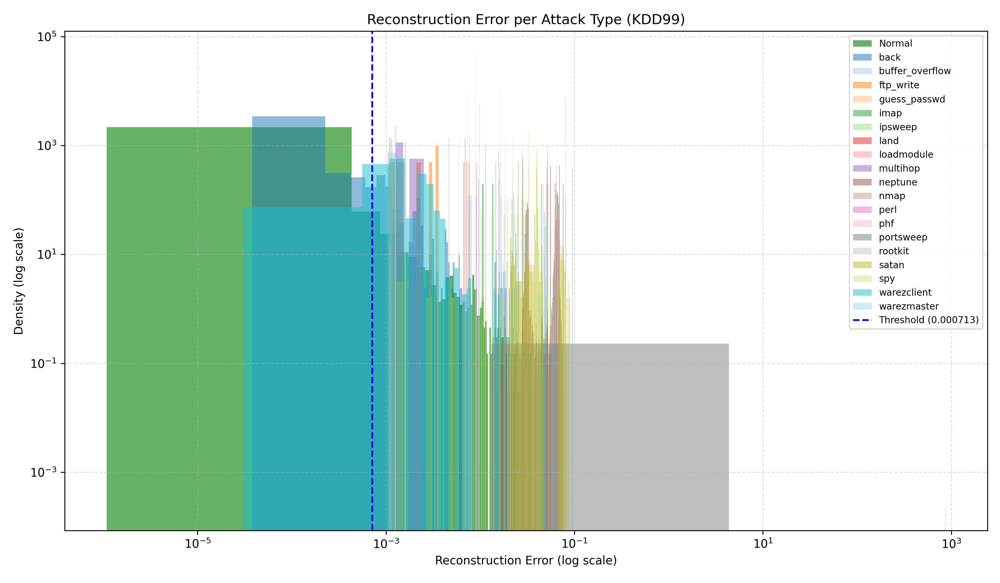

# FedSAD: Federated Learning-based Anomaly Detection in Software-Defined Perimeter Architecture for Distributed Authentication

Official implementation of the **FedSAD** framework, designed for secure and distributed anomaly detection within Software-Defined Perimeter (SDP) architectures.

## Overview

FedSAD is a novel framework that integrates **Federated Learning (FL)** with **Anomaly Detection** to enhance security in SDP-based environments. It focuses on distributed authentication and identifying malicious activities while preserving data privacy across multiple nodes.

This repository provides the core logic for the FedSAD model, including comparison baselines, evaluation scripts, experimental results, dataset preprocessing details, and hyperparameter settings used in the paper.

## Unified experiment interface

This branch adds a single public entry point, **`run.py`**, for model selection, data preparation, training, evaluation and figure generation. The previous implementations are preserved in `experiment/_legacy/` and loaded through adapters; their model source files remain available for inspection. Evaluation programs are separate from the regression tests in `tests/`.

- **`results/`** contains the archived manuscript artifacts and is not a destination for new experiments.
- **`outputs/`** contains newly generated weights, PNG figures, metrics, predictions and resolved settings.
- **`runtime/`** contains training logs, source snapshots, intermediate checkpoints and exact evaluation caches.
- The default is **30 local epochs per FL client**, **10 server rounds**, **15 clients**, and **seed 123**. For centralized graph models, `--epochs` is the centralized epoch count.

The archived project background, dataset descriptions, sampling strategy, research environment, hyperparameter table and citation are retained below. Their historical settings are distinct from the defaults of a new run.

## Installation

Use Python **3.9** and a dedicated environment. The working environment on the development server is `sdp_fl`.

```bash
conda create -n sdp_fl python=3.9
conda activate sdp_fl
python -m pip install -r requirements.txt
python run.py --help
python run.py --list
```

Core versions: TensorFlow 2.14.1, Keras 2.14.0, Flower 1.19.0, Ray 2.31.0, NumPy 1.25.2, pandas 2.3.1 and scikit-learn 1.6.1. `requirements.txt` records the versions from the working environment; `requirements/legacy.txt` preserves the previous dependency list. A fresh installation and every CUDA combination have not been separately validated.

MV-IDS and MM-FewShot-IDS additionally require the PyTorch dependencies:

```bash
python -m pip install -r requirements/optional-graph.txt
```

Choose a PyTorch build compatible with the machine's CUDA environment. The TensorFlow `sdp_fl` environment used for interface verification does not have the optional PyTorch packages installed.

## Directory structure

```text
.
├── run.py                         # Only public Python entry point at repository root
├── configs/                       # Default values and reusable JSON experiment settings
├── experiment/
│   ├── cli.py                     # Model/dataset/parameter selection and validation
│   ├── runner.py                  # Prepare → train → evaluate → export
│   ├── artifacts.py               # Run directories, provenance and results/ protection
│   ├── backends.py                # Lazy imports of the preserved model implementations
│   ├── datasets/                  # Dataset paths, transformations, splits and frozen arrays
│   ├── models/                    # Model registry and construction
│   ├── trainers/                  # RNEP, FedAvg and graph-model training adapters
│   ├── evaluation/                # Prediction scores, thresholds and metric export
│   ├── plotting/                  # CM, ROC, reconstruction error and recall figures
│   └── _legacy/                   # Preserved implementation source; internal adapter dependency
├── tests/                         # Regression tests, not benchmark evaluation entry points
├── plot_data/                     # Original numeric inputs for manuscript comparison plots
├── results/                       # Archived manuscript results, kept separate from new runs
├── outputs/                       # New final artifacts (created on first run, Git-ignored)
├── runtime/                       # Logs/checkpoints/source/cache (created on first run, Git-ignored)
├── docs/                          # Original README, architecture summary and audit manifests
└── requirements/                  # Historical and optional dependency lists
```

Archived ROC score tables and recall comparison PNG/CSV files are stored directly in their corresponding `results/<dataset>/` directories. Combined ROC figures and their summary CSV are stored directly under `results/`. The former shared plot directories have been removed; [docs/results_layout.json](docs/results_layout.json) records the moves and associated plotting-script path updates.

The Git repository includes archived figures, metrics, final weights and client-study completion records. Raw datasets, new `outputs/`, `runtime/`, intermediate checkpoints, local notification state and redundant client-run artifacts stay outside version control. Round checkpoint links are local artifacts; published round results retain their validation metrics.

## Models and dataset support

| Model option | Training | Supported datasets |
| --- | --- | --- |
| `taae` | Normal-only Transformer AAE with RNEP aggregation | KDD99, NSL-KDD, InSDN, CSE-CIC-IDS2018, UNSW-NB15, CICIoT2023, GeNIS, Gotham, ITU/ULAK |
| `aelstm` | Labeled AE-LSTM with FedAvg | KDD99, NSL-KDD, InSDN, CSE-CIC-IDS2018, UNSW-NB15, CICIoT2023, GeNIS |
| `cnnlstm` | Labeled CNN-LSTM with FedAvg | KDD99, NSL-KDD, InSDN, CSE-CIC-IDS2018, UNSW-NB15, CICIoT2023, GeNIS |
| `mvids` | MV-IDS centralized multi-view model | CSE-CIC-IDS2018 and UNSW-NB15, using the original feature schema |
| `mmfewshotsids` | Centralized multimodal few-shot classifier | CSE-CIC-IDS2018 and UNSW-NB15, using the original feature schema |

`mnids` is accepted as an alias for this repository's `mvids` implementation. Unsupported combinations are rejected before training. Adding a dataset to the CLI does not invent missing graph or packet-sequence features.

For TAAE, `--variant previous` is the default; `--variant current` selects the newer implementation. The preserved previous model's source fit call does not pass `prior_labels`, so its adversarial loss is inactive during fitting, matching the previous implementation. The current variant has its own training-step behavior. The two variants are recorded explicitly in each run.

## Dataset preparation and paths

Keep datasets outside the Git repository. For an encoded numeric benchmark, `--data-dir` points to a directory containing a matching normal/anomaly pair. The CSVs must have the same ordered feature schema.

```text
IDS_Datasets/
├── KDD99/
│   ├── KDD99_normal.csv          # Manuscript subset: 76,812 rows, 115 numeric features
│   ├── KDD99_anomaly.csv         # Manuscript subset: 113,252 rows, same 115 features
│   └── KDD99_encoded.csv         # Optional original subtype labels for recall/distribution figures
├── NSL-KDD/
│   ├── KDD_normal.csv
│   └── KDD_anomaly.csv
└── GeNIS/
    └── raw/
        ├── 0-info/genis-features.csv
        └── 3-scenarios/scenarios-10-sec/*.csv
```

For GeNIS, download the official `0-info.zip` and `3-scenarios.zip` archives from the [dataset record](https://zenodo.org/records/14919237), and arrange the extracted files as shown above. `--data-dir` should point to the `GeNIS` directory. `--prepared` can instead reuse an existing prepared split whose source hash, seed and flow interval match.

`--data-root` defaults to `~/IDS_Datasets`; `--data-dir` overrides a dataset's location. The installed CIC2018, CICIoT2023 and UNSW numeric CSV defaults use `/data/SDP_Dataset/Unified_model/`. Graph models use `--data-dir /path/to/features.csv` and require their respective published feature columns. They cannot directly consume the 115-feature KDD99 CSVs.

Numeric KDD99/NSL-KDD TAAE runs retain the normal 50:50 train/test split and all attack rows in the final test. MinMax is fitted on normal training rows. Thus KDD99's native test is **38,406 normal + 113,252 attack rows**, not a balanced test. Supervised KDD99 recipes retain their original attack-training fractions (AE-LSTM 0.05, CNN-LSTM 0.2). These legacy protocols are distinct from the shared GeNIS holdout.

CICIoT2023 retains its model-specific preparation: TAAE uses the existing selected-column `log1p` transform, an 80:20 normal split and a balanced 40,000:40,000 final test. AE-LSTM/CNN-LSTM retain their original normal/attack 50:50 splits, normal-training MinMax scaling and padded `(10, 8)` input. UNSW sequence models retain the original `(6, 7)` reshape, including the legacy truncation to 42 positions; the data report identifies the feature columns actually used.

The original InSDN AE-LSTM loader uses a 50:50 normal split, whereas the InSDN TAAE and CNN-LSTM loaders use 80:20. These model-specific defaults are retained and can be explicitly overridden with `--normal-train-ratio`.

The default attack-training fractions for AE-LSTM are 0.05 on KDD99/InSDN/UNSW and 0.2 on NSL-KDD/CIC2018. CNN-LSTM uses 0.4 on InSDN and 0.2 on those other numeric benchmarks. Both use 0.5 on CICIoT2023/GeNIS; `--attack-fraction` overrides these defaults.

For numeric benchmarks, round validation uses each client's original internal validation tail, and TAAE uses a fixed normal-training percentile. GeNIS/Gotham provide independent labeled validation, allowing validation-selected thresholds. The test is used only for final reporting. Dataset reports record the actual split and sample counts.

## Run experiments

Inspect the final settings before starting an expensive run:

```bash
python run.py --model taae --dataset kdd99 --dry-run
```

Run KDD99 with the default **30 epochs**:

```bash
python run.py --model taae --dataset kdd99 --gpus 0
```

Or select parameters explicitly:

```bash
python run.py --model taae --dataset kdd99 \
  --variant previous --clients 15 --rounds 10 --epochs 30 \
  --batch-size 16 --lr 3e-5 --seed 123 \
  --data-dir /path/to/IDS_Datasets/KDD99 --gpus 0,1
```

Select GeNIS and a model:

```bash
python run.py --model taae --dataset genis --epochs 30
python run.py --model aelstm --dataset genis --epochs 30
python run.py --model cnnlstm --dataset genis --epochs 30
```

For centralized graph models, supply their required feature CSV after installing PyTorch:

```bash
python run.py --model mvids --dataset unsw-nb15 --epochs 30 \
  --data-dir /path/to/UNSW_NB15_preprocessed.csv --gpus 0
python run.py --model mmfewshotsids --dataset cic2018 --epochs 30 \
  --data-dir /path/to/NF-CICIDS2018-v3-balanced.csv --gpus 0
```

Use a JSON preset. Explicit command-line options override the JSON values:

```bash
python run.py --config configs/kdd99_taae.json --epochs 30 --gpus 0
python run.py --config configs/genis_taae.json --dry-run
```

Run the same model/data at several client counts; each gets its own run directory, followed by a comparison:

```bash
python run.py --model taae --dataset genis \
  --clients 5 10 15 20 25 30 --rounds 10 --epochs 30
```

`--repeats N` creates separate experiments with `seed`, `seed+1`, and so on. `--gpus cpu --execution serial` executes the same FL protocol sequentially on CPU. The small verification fixtures used in tests are not benchmark results.

## Outputs and evaluation

Every new experiment creates a unique directory. An existing run name is rejected to avoid accidental replacement.

```text
outputs/<dataset>/<model>/<run-id>/
├── weights/model.h5              # TensorFlow models; graph models use model.pt
├── figures/
│   ├── confusion_matrix.png
│   ├── roc.png
│   ├── reconstruction_error.png   # TAAE and AE-LSTM
│   ├── per_attack_recall.png
│   └── round_metrics.png          # FL models
├── tables/
│   ├── metrics.csv
│   ├── per_attack.csv
│   ├── predictions.csv
│   ├── roc_data.csv
│   └── round_metrics.csv
├── metadata/
│   ├── metrics.json
│   ├── threshold.json
│   ├── data.json
│   └── source.json
├── preprocessing.joblib
├── config.json
└── status.json
```

`metrics.csv` records Normal, Anomaly, macro and weighted metrics. Binary anomaly scores always increase toward Anomaly. The primary AE-LSTM result is its **classification head**; its reconstruction metrics are auxiliary and saved separately. Graph models use their source classification decision convention, recorded in the metrics.

Per-attack plots use verified subtype metadata when available; otherwise the binary attack group is labeled `Anomaly`.

`--threshold-policy auto` selects TAAE's percentile by **validation macro F1** when an independent two-class validation set exists; otherwise it uses the fixed normal-training `--percentile`. `--threshold-policy fixed` forces the fixed percentile. Validation-selected thresholds are never selected on test labels.

Evaluate the saved model without retraining. The saved runtime evaluation cache is hash-checked and must remain available:

```bash
python run.py --mode evaluate --run outputs/<dataset>/<model>/<run-id> --gpus 0
```

Regenerate plots from the saved predictions, without TensorFlow/PyTorch inference:

```bash
python run.py --mode plot --run outputs/<dataset>/<model>/<run-id>
```

Compare completed unified runs:

```bash
python run.py --mode compare --runs \
  outputs/genis/taae/<run-id> outputs/genis/cnnlstm/<run-id>
```

Comparisons are saved to `outputs/comparisons/`. Logs, source snapshots and checkpoints are under `runtime/<dataset>/<model>/<run-id>/`. New output paths resolving into `results/`, including symbolic links, are rejected. The completed legacy client-count study in `results/clients/` retains its original destination; new client sweeps use `outputs/`.

## Effect of client count on GeNIS

The intended client-count configuration is **5, 10, 15, 20, 25 and 30 clients**, **10 server rounds and 30 local epochs per client per round**, using the preserved **previous TAAE model and RNEP aggregation**, latent dimension 64, batch size 16, learning rate `3e-5`, dropout 0.1 and seed 123. Use `--epochs 30`, as in the experiment command above.

### Archived measurements

The table and figures below retain the existing measurements, which were produced with **70 local epochs per client per round**. They are an archive of that configuration and **are not 30-epoch results**. This update changes the documented experiment setting to 30 epochs; the archived measurements have not been recomputed.

The same ordered pool of **31,123 normal training rows** was partitioned using `numpy.array_split`; increasing the client count changes the partition sizes, not the total training pool. All runs share the same **7,630 validation rows** (3,815 normal and 3,815 attack) and **8,746 test rows** (4,373 normal and 4,373 attack), with the same preprocessing and frozen implementation source. The recorded source/data hashes, partition sizes and full settings are in [experiment_config.json](results/clients/experiment_config.json) and [partition_summary.csv](results/clients/partition_summary.csv).

The table reports the final model after round 10. Each run's percentile was selected by **validation macro F1** and then applied to the held-out test set. **Precision, Recall and F1-score refer to Anomaly (1)**; Macro F1 averages the Normal and Anomaly F1 scores. Scores are on a 0–1 scale, rounded to four decimal places.

| Clients | Selected percentile | Accuracy | Precision | Recall | F1-score | Macro F1 | ROC-AUC |
| ---: | ---: | ---: | ---: | ---: | ---: | ---: | ---: |
| 5 | 97.14 | 0.9601 | 0.9286 | 0.9968 | 0.9615 | 0.9600 | 0.9888 |
| 10 | 97.98 | 0.9792 | 0.9629 | 0.9968 | 0.9796 | 0.9792 | 0.9900 |
| **15** | 98.15 | **0.9820** | 0.9674 | 0.9977 | 0.9823 | **0.9820** | **0.9904** |
| 20 | 97.81 | 0.9803 | 0.9642 | 0.9977 | 0.9807 | 0.9803 | 0.9901 |
| 25 | 97.82 | 0.9793 | 0.9645 | 0.9952 | 0.9796 | 0.9793 | 0.9894 |
| 30 | 97.69 | 0.9790 | 0.9621 | 0.9973 | 0.9793 | 0.9790 | 0.9890 |

The [full comparison CSV](results/clients/client_comparison.csv) contains both the validation-selected results above and the fixed-percentile-82 control. The figure below shows both policies; [round_comparison.png](results/clients/round_comparison.png) separately shows round-by-round validation performance at the fixed percentile.



### Interpretation of the archived measurements

- **15 clients performs best in this run.** Relative to 5 clients, accuracy improves by **2.20 percentage points**. Most of the difference comes from fewer normal samples being flagged as attacks: false positives fall from **335 to 147**, and Normal recall rises from **92.34% to 96.64%**. Missed attacks also decrease from 14 to 10. Thus the gain reflects improved balance between normal acceptance and attack detection, while attack recall remains high.
- **More clients do not produce a monotonic improvement.** With 10–30 clients, accuracy stays within **97.90–98.20%**, a spread of approximately **0.31 percentage points**. Increasing the count beyond 15 gives no consistent predictive benefit in these measurements. The training pool per client decreases from 6,224–6,225 rows at 5 clients to 1,037–1,038 at 30 clients. Smaller partitions, fewer optimizer steps per client per local epoch and different RNEP pairings are possible contributors to the trend; this experiment does not isolate their individual effects.
- **Threshold calibration materially affects the comparison.** At the fixed percentile of 82, accuracy is only **88.07–89.64%** and Normal recall is **76.15–79.28%**, despite very high attack recall. The fixed-threshold control has its highest accuracy at **20 clients**, whereas validation-selected thresholds give the highest accuracy at **15 clients**. ROC-AUC is threshold-independent and also peaks at 15 clients, although the AUC differences are small. Threshold-dependent results should therefore be compared under the same selection policy.
- **The conclusion is specific to this protocol.** These are single-seed measurements with a shared shuffled-row partitioning recipe. They support 15 clients as a reference setting for this GeNIS experiment, but do not establish a universally optimal client count or a statistically significant advantage. Repeated seeds and non-IID client partitions would be needed to assess how reliably the ordering generalizes.

Per-client artifacts, confusion matrices and completion checks are under `results/clients/clients_<N>/`; see the [study README](results/clients/README.md) for the directory contents.

## Archived reconstruction-error figures

These figures link to the manuscript artifacts in `results/`; they are not regenerated by training a new model. They show normal/attack reconstruction-error distributions and the stored decision threshold.

| KDD99 | InSDN |
| --- | --- |
|  |  |
| **CSE-CIC-IDS2018** | **UNSW-NB15** |
|  |  |
| **GeNIS** | |
|  | |

The archived combined ROC curve includes GeNIS:


## Code validation and archived source

```bash
CUDA_VISIBLE_DEVICES=-1 python -B -m unittest discover -s tests -v
```

The original source README is preserved in `docs/upstream_README.md`. `docs/backend_source_hashes.json` records the original backend hashes; later plotting-path updates are recorded separately in `docs/results_layout.json`. Old `test_*.py` programs inside `_legacy/` are internal evaluation adapters; the public evaluation command is `run.py --mode evaluate`. Optional graph-model adapters require their own installed framework and feature CSVs; the TensorFlow regression checks do not establish graph benchmark performance.

Interface verification covers all five model adapters on small fixtures, saved-weight reevaluation, plotting and run comparison. The optional graph paths were exercised separately on CPU with PyTorch 2.6.0. Actual GeNIS adapters were checked for identical evaluation row IDs across TAAE, AE-LSTM and CNN-LSTM; CICIoT transformations were checked against the preserved loaders. These checks establish execution and data compatibility, not benchmark accuracy.

The refactor checks and the KDD99 verification run are recorded in [docs/refactor_verification.json](docs/refactor_verification.json).

## Original study details

The following sections retain the original manuscript descriptions and historical settings. New experiments are identified by their own resolved configuration, data hashes and run ID.

## Experimental Environment

All experiments were conducted on a server with the following specifications.

- CPU: Dual Intel Xeon Gold 5218R processors
- Memory: 503 GB RAM
- GPU: 3 × NVIDIA RTX A6000 GPUs (48 GB VRAM each)
- Operating System: Ubuntu 22.04.1 LTS
- CUDA Version: 12.2

For federated learning experiments, we implemented our training pipeline using the Flower framework (`flwr==1.19.0`) on Python 3.9.23. We extended and overrode the default aggregation strategy to integrate the RNEP-based entropy-aware pairing mechanism.

## Federated Learning Implementation

The proposed FedSAD framework is implemented using the Flower federated learning framework.

The default aggregation strategy was customized to support the proposed **RNEP-based entropy-aware pairing mechanism**. Instead of relying only on conventional centralized aggregation such as FedAvg, the proposed method considers entropy-based node information during federated aggregation.

The implementation includes:

- Federated client-side training
- RNEP-based entropy-aware node pairing
- Entropy-based aggregation logic
- Communication-efficient model synchronization
- Privacy-preserving distributed anomaly detection

## Datasets

To evaluate the proposed framework, we use five widely adopted intrusion detection datasets for fair comparison with existing IDS baselines.

| Dataset | Normal Samples | Anomaly Samples | Purpose |
| :--- | :--- | :--- | :--- |
| KDD99 | 76,812 | 113,252 | Comparison with AE-LSTM-based anomaly detection models |
| NSL-KDD | 61,442 | 90,848 | Evaluation on an improved KDD-based IDS benchmark |
| InSDN | 68,424 | 138,772 | Benchmarking CNN-LSTM approaches in SDN environments |
| CSE-CIC-IDS2018 | 200,000 | 200,000 | Comparison with multimodal IDS frameworks |
| UNSW-NB15 | 1,959,772 | 99,643 | Evaluation on modern IDS traffic and comparison with multimodal frameworks |

### Dataset Descriptions

**KDD99** is a classic intrusion detection benchmark derived from the 1999 DARPA evaluation program. It contains connection-level flow records with attack categories such as DoS, Probe, Remote-to-Local (R2L), and User-to-Root (U2R). We use 76,812 normal samples and 113,252 anomaly samples.

**NSL-KDD** is an improved variant of KDD99 designed to alleviate the severe class imbalance and redundancy problems present in the original dataset. We use 61,442 normal samples and 90,848 anomaly samples.

**InSDN** is an intrusion detection dataset collected from an SDN environment. It contains both benign traffic and attack scenarios such as ARP spoofing and TCP SYN flooding. We use 68,424 normal samples and 138,772 anomaly samples.

**CSE-CIC-IDS2018** is a large-scale dataset composed of realistic benign activities and diverse attack scenarios, including web attacks, brute force, botnets, and DDoS attacks. Given its large scale, we randomly sample 200,000 normal and 200,000 anomaly instances for our experiments.

**UNSW-NB15** is a modern IDS dataset generated using the IXIA PerfectStorm platform. It includes modern attack types such as Exploits, Reconnaissance, and Shellcode. We use 1,959,772 normal samples and 99,643 anomaly samples.

### GeNIS (added in this branch)

**GeNIS: GECAD Network Intrusion Scenarios** provides enterprise network traffic from simulated attack scenarios, including labeled flow CSVs at 5, 10, 30 and 60 second intervals. The official dataset is available from [Zenodo](https://zenodo.org/records/14919237); please also cite its [primary data article](https://doi.org/10.1016/j.dib.2025.111487).

This implementation uses the published **10-second scenario CSVs** by default. It removes records reused across scenario files, groups related records by connection/window, and preserves signed measurements. Identifiers, timestamps and exporter bookkeeping are excluded from model input. Median imputation, MinMax scaling and one-hot encoding are fitted on the training partition. TAAE fits these transforms on normal training rows; the sequence classifiers fit their transforms on their labeled training rows.

The archived seed-123 comparison uses 31,123 normal TAAE training rows, 7,630 validation rows and 8,746 test rows. Validation and test are each balanced between normal and attack traffic. AE-LSTM and CNN-LSTM use the same validation/test source rows as TAAE, while preserving their supervised training protocol. A sequence input packs the features of one flow; it is not a temporal window across unrelated flows. The preprocessing report records feature dimensions, overlap checks and attack types absent from training.

The documented GeNIS experiment configuration uses **30 local epochs and 10 server rounds**, matching the unified interface default. Existing checkpoints retain the actual training settings recorded in their `model_config.json`; their evaluation results are tied to those saved settings and splits. Dataset and preprocessing hashes are recorded for every new experiment.

## Dataset Preprocessing

To bridge the gap between benchmark datasets and practical SDP deployment, packet-level datasets, including CSE-CIC-IDS2018 and UNSW-NB15, are processed through a data pipeline that extracts log-consistent features aligned with real SDP operational logs.

The preprocessing pipeline includes:

- Packet-level feature extraction
- Session-level feature construction
- Log-consistent representation generation
- Normalization and label transformation
- Train-test split according to the evaluation setting

Across all datasets, we apply different train-test split strategies depending on the evaluation purpose.

For the federated training comparison, including Centralized Baseline, FedAvg, and RNEP, we use a 50:50 split of normal samples for training and testing. In contrast, for the packet-level and unified model evaluation, we use an 80:20 train-test split.

## CSE-CIC-IDS2018 Sampling Strategy

The original CSE-CIC-IDS2018 dataset contains 13,484,694 normal samples and 2,748,235 anomaly samples. Given its large scale, we randomly sample 200,000 normal and 200,000 anomaly instances for our experiments.

For anomaly samples, rare attack types are used as-is, while high-frequency attack types are proportionally downsampled to preserve attack diversity while preventing dominant classes from overwhelming the training process.

| Attack Type | Sampling Method | Sampled | Original |
| :--- | :--- | ---: | ---: |
| SQL Injection | Use As-Is | 87 | 87 |
| Brute Force-XSS |  | 230 | 230 |
| Brute Force-Web |  | 611 | 611 |
| DDoS Attack-LOIC-UDP |  | 1,730 | 1,730 |
| DoS Attack-Slowloris |  | 10,990 | 10,990 |
| DoS Attack-GoldenEye | | 41,508 | 41,508 |
| DoS Attack-SlowHTTPTest | Proportional Downsampling | 7,524 | 139,890 |
| Infiltration |  | 8,709 | 161,934 |
| Brute Force-SSH |  | 10,088 | 187,589 |
| Brute Force-FTP |  | 10,400 | 193,360 |
| Bot |  | 15,392 | 286,191 |
| DoS Attack-Hulk | | 24,844 | 461,912 |
| DDoS Attack-LOIC-HTTP |  | 30,990 | 576,191 |
| DDoS Attack-HOIC |  | 36,897 | 686,012 |

## Hyperparameter Settings

The table below describes the original manuscript settings. New runs use the resolved values saved in their `config.json`; the unified CLI default is 30 epochs.

The following hyperparameters were used for the compared models.

| Parameters | CNN-LSTM | AE-LSTM | MM-FEWSHOTS-IDS | MV-IDS | Ours |
| :--- | :--- | :--- | :--- | :--- | :--- |
| No. of Classes | 2 | 2 | 2 | 2 | 2 |
| Batch Size | 8, 32 | 64, 128 | 32 | 128 | 8, 32 |
| Dropout Rate | 0.1, 0.25, 0.5 | 0.001 | 0.1 | 0.3 | 0.1 |
| Learning Rate | 0.0001 | 0.001 | 0.001 | 0.0001 | 0.0001 |
| Optimizer | Adam | Adam | Adam | Adam | Adam |
| Activation | ReLU, Softmax | ReLU, Sigmoid | ReLU, Softmax | ReLU, Softmax | LeakyReLU, ReLU, Sigmoid |
| Loss Function | BCE | MSE | CE | BCE | MSE, BCE |

## Reproducibility

Due to manuscript space limitations, detailed implementation and training procedures could not be fully included in the paper. Therefore, this repository provides supplementary details to facilitate reproducibility.

This repository includes:

- Source code for the proposed FedSAD framework
- GSAD implementation
- TAAE implementation
- RNEP-based federated aggregation logic
- Dataset preprocessing procedures
- Experimental configurations
- Hyperparameter settings
- Server and software environment details
- Evaluation scripts and result-saving scripts
- Model architecture summary
- Saved TAAE model weights

The implementation corresponds to the experimental setup reported in the paper.

## Citation

If you use this repository in your research, please cite:

<!-- ```bibtex
@article{FedSAD,
  title={FedSAD: Federated Learning-based Anomaly Detection in Software-Defined Perimeter Architecture for Distributed Authentication},
  author={Anonymous},
  journal={Under Review},
  year={2026}
}
``` -->
