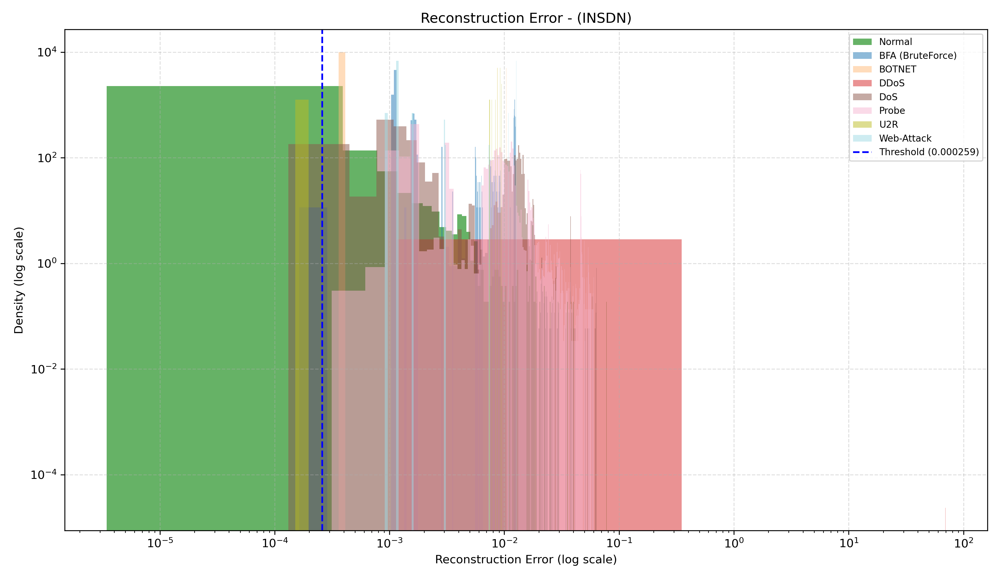
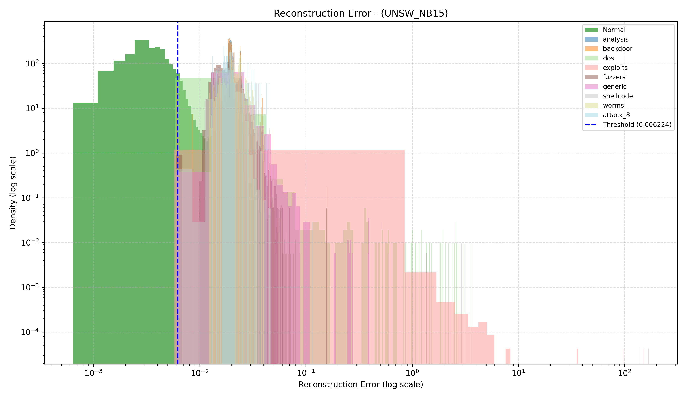
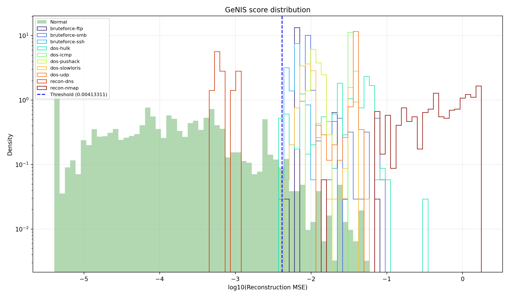
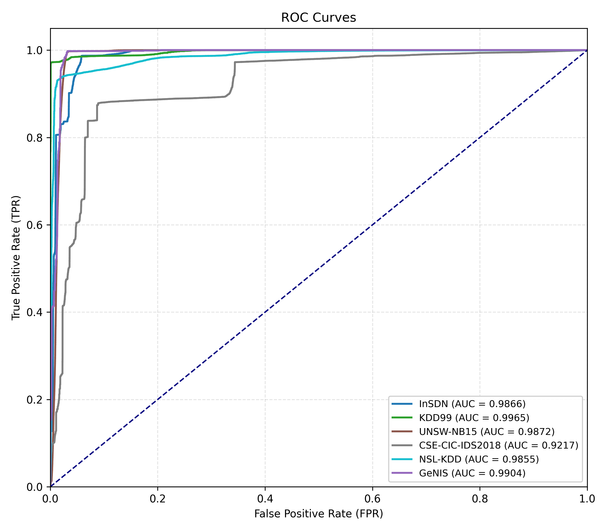
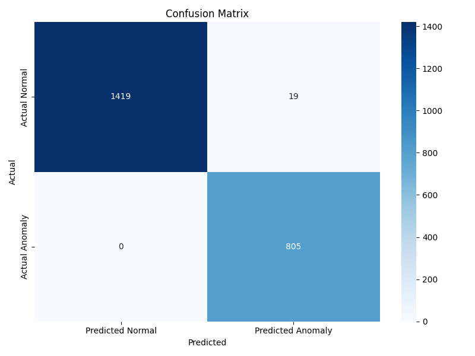

# FedSAD: Federated Learning-based Anomaly Detection in Software-Defined Perimeter Architecture for Distributed Authentication

Official implementation of the **FedSAD** framework, designed for secure and distributed anomaly detection within Software-Defined Perimeter (SDP) architectures.

## Overview

FedSAD is a novel framework that integrates **Federated Learning (FL)** with **Anomaly Detection** to enhance security in SDP-based environments. It focuses on distributed authentication and identifying malicious activities while preserving data privacy across multiple nodes.

FedSAD combines two detectors and fuses their evidence with Dempster-Shafer theory for every detection window:

- **TAAE** (Transformer Adversarial Autoencoder), trained with federated learning and the **RNEP** entropy-aware aggregation
- **GSAD** (graph-based anomaly detection), which compares each window's port-communication graph with normal statistics

This repository provides the FedSAD source code, the comparison baselines, evaluation scripts, the archived experimental results, dataset preprocessing details and the hyperparameter settings used in the paper.

## Quick start

```bash
conda create -n sdp_fl python=3.9
conda activate sdp_fl
python -m pip install -r requirements.txt
python run.py --list                                  # supported model/dataset pairs
python run.py --model taae --dataset kdd99 --dry-run  # show the resolved settings
python run.py --model fedsad --dataset genis          # FedSAD with the archived TAAE weights
```

Core versions: TensorFlow 2.14.1, Keras 2.14.0, Flower 1.19.0, Ray 2.31.0, NumPy 1.25.2, pandas 2.3.1 and scikit-learn 1.6.1. `requirements.txt` records the versions from the working environment. A fresh installation and every CUDA combination have not been separately validated.

MV-IDS and MM-FewShot-IDS additionally require PyTorch. Choose a build that matches the machine's CUDA version:

```bash
python -m pip install -r requirements/optional-graph.txt
```

All commands in this README run from the repository root.

## Directory structure

```text
.
├── run.py                         # Single entry point: train, evaluate, plot, compare
├── configs/                       # Default values and JSON experiment presets
├── experiment/
│   ├── cli.py                     # Model/dataset/parameter selection and validation
│   ├── registry.py                # Supported model/dataset pairs and model construction
│   ├── runner.py                  # Prepare → train → evaluate → export
│   ├── artifacts.py               # Run directories, provenance and results/ protection
│   ├── backends.py                # Lazy imports of the implementations in core/
│   ├── datasets/                  # Dataset paths, transformations and splits
│   ├── trainers/                  # Federated (RNEP/FedAvg), graph-model and FedSAD adapters
│   ├── evaluation/                # Scores, thresholds and metric export
│   ├── plotting/                  # Confusion matrix, ROC, reconstruction error and recall figures
│   └── core/                      # Model implementations and the original experiment pipelines
│       ├── fedsad.py              # FedSAD: GSAD + TAAE with Dempster-Shafer fusion
│       ├── gsad.py                # GSAD
│       ├── train_*.py             # Training entry points (see "Models")
│       ├── models/                # All model definitions
│       ├── scripts/               # Evaluation of archived weights, GeNIS tools, window sweep, paper figures
│       └── utils/                 # Dataset loaders, metrics, window metrics, GeNIS/Gotham helpers
├── tests/                         # Regression tests (not benchmark evaluations)
├── plot_data/                     # Numeric inputs for the recall comparison figures
├── results/                       # Archived paper results (read-only for new runs)
├── outputs/                       # New run results (created on first run, Git-ignored)
├── runtime/                       # Logs, source snapshots and caches (created on first run, Git-ignored)
└── requirements/                  # Optional dependency lists
```

## Models

| Model | `run.py --model` | Model definition | Training script | Evaluation of archived weights |
| --- | --- | --- | --- | --- |
| **FedSAD** (ours) | `fedsad` | `core/fedsad.py`, `core/gsad.py` | — (uses TAAE weights) | `core/scripts/evaluate_gsad.py` |
| **TAAE + RNEP** (ours) | `taae` | `core/models/taae_previous.py`, `taae_current.py` | `core/train_taae.py` | `core/scripts/evaluate_taae.py` |
| AE-LSTM | `aelstm` | `core/models/aelstm.py` | `core/train_aelstm.py` | `core/scripts/evaluate_aelstm.py` |
| CNN-LSTM | `cnnlstm` | `core/models/cnnlstm.py` | `core/train_cnnlstm.py` | `core/scripts/evaluate_cnnlstm.py` |
| MV-IDS | `mvids` (alias `mnids`) | `core/models/mvids/` | `core/train_mvids.py` | `core/scripts/evaluate_mvids.py` |
| MM-FewShot-IDS | `mmfewshotsids` | `core/models/mmfewshotsids/` | `core/train_mmfewshotsids.py` | `core/scripts/evaluate_mmfewshotsids.py` |
| TAAE + FedAvg | — | `core/models/taae_previous.py` | `core/train_fedavg.py` | — |
| TAAE, centralized (CML) | — | `core/models/taae_previous.py` | `core/train_cml.py` | — |

`core/` stands for `experiment/core/`.

**TAAE variants.** `taae_previous` (latent dimension 64) is the model behind every archived TAAE, FedSAD, FedAvg and CML weight in `results/`. `taae_current` (latent dimension 32) is a newer variant. `run.py --variant previous` is the default; `--variant current` selects the newer model. The previous model's fit call does not pass `prior_labels`, so its adversarial loss is inactive during fitting, as in the original implementation.

### Supported datasets in `run.py`

| Model | Datasets |
| --- | --- |
| `taae` | KDD99, NSL-KDD, InSDN, CSE-CIC-IDS2018, UNSW-NB15, GeNIS, Gotham, ITU/ULAK |
| `aelstm`, `cnnlstm` | KDD99, NSL-KDD, InSDN, CSE-CIC-IDS2018, UNSW-NB15, GeNIS |
| `mvids`, `mmfewshotsids` | CSE-CIC-IDS2018, UNSW-NB15 (original feature schema) |
| `fedsad` | CSE-CIC-IDS2018, UNSW-NB15, GeNIS (RNEP frame data) |

Unsupported combinations are rejected before training. Dataset aliases: `kdd` → `kdd99`, `nsl` → `nsl-kdd`, `cic` → `cic2018`, `unsw` → `unsw-nb15`, `zenodo` → `itu-ulak`.

## Running experiments with `run.py`

Every run gets its own directory under `outputs/`; an existing run name is rejected. Defaults: **30 local epochs per FL client, 10 server rounds, 15 clients, seed 123** (`configs/defaults.json`). For centralized graph models, `--epochs` is the centralized epoch count.

```bash
# TAAE with RNEP
python run.py --model taae --dataset kdd99 --gpus 0
python run.py --model taae --dataset kdd99 \
  --variant previous --clients 15 --rounds 10 --epochs 30 \
  --batch-size 16 --lr 3e-5 --seed 123 \
  --data-dir /path/to/IDS_Datasets/KDD99 --gpus 0,1

# Compare sequence baselines on the same dataset
python run.py --model aelstm --dataset genis
python run.py --model cnnlstm --dataset genis

# Graph baselines (PyTorch required) with their feature CSVs
python run.py --model mvids --dataset unsw-nb15 --data-dir /path/to/UNSW_NB15_preprocessed.csv --gpus 0
python run.py --model mmfewshotsids --dataset cic2018 --data-dir /path/to/NF-CICIDS2018-v3-balanced.csv --gpus 0

# JSON presets; explicit options override the JSON values
python run.py --config configs/kdd99_taae.json --gpus 0
python run.py --config configs/genis_taae.json --dry-run

# Several client counts: one run each, followed by a comparison
python run.py --model taae --dataset genis --clients 5 10 15 20 25 30
```

`--repeats N` creates separate runs with `seed`, `seed+1`, and so on. `--gpus cpu --execution serial` runs the same FL protocol sequentially on CPU. `--dry-run` prints the resolved configuration without training.

### FedSAD

FedSAD fits the GSAD normal statistics for the chosen detection window and fuses GSAD with TAAE. It uses the archived TAAE weights in `results/` unless `--taae-weights` points to another model (for example one trained with `--model taae`).

```bash
python run.py --model fedsad --dataset genis --time-window 1min
python run.py --model fedsad --dataset cic --time-window 2min \
  --taae-weights outputs/cic2018/taae/<run-id>/weights/model.h5
```

| Option | Default | Meaning |
| --- | --- | --- |
| `--time-window` | `1min` | Detection window (e.g. `30s`, `1min`, `2min`, `4min`) |
| `--threshold-std` | 0.25 (CIC2018), 5 (UNSW-NB15), 1 (GeNIS) | GSAD deviation threshold *k* |
| `--episode-gap` | `5min` | Gap that starts a new attack episode (time-to-detect) |
| `--taae-weights` | archived weights | TAAE weights to fuse with GSAD |

A FedSAD run writes `tables/window_metrics.json` (precision, recall, F1, FPR, inference time, detection delay), `tables/fedsad_server.txt`, `figures/confusion_matrix.png` and the GSAD statistics in `weights/normal_stats.pkl`. It is evaluated while it runs, so `--mode evaluate` and `--mode plot` do not apply.

### Outputs, re-evaluation and comparison

```text
outputs/<dataset>/<model>/<run-id>/
├── weights/model.h5              # TensorFlow models; graph models use model.pt
├── figures/                      # confusion_matrix, roc, reconstruction_error, per_attack_recall, round_metrics
├── tables/                       # metrics, per_attack, predictions, roc_data, round_metrics (CSV)
├── metadata/                     # metrics, threshold, data and source hashes (JSON)
├── preprocessing.joblib
├── config.json
└── status.json
```

`metrics.csv` records Normal, Anomaly, macro and weighted metrics. Anomaly scores always increase toward Anomaly. The primary AE-LSTM result is its **classification head**; its reconstruction metrics are auxiliary. Per-attack plots use verified subtype labels when available; otherwise the attack group is labeled `Anomaly`.

`--threshold-policy auto` selects TAAE's percentile by **validation macro F1** when an independent two-class validation set exists (GeNIS, Gotham); otherwise it uses the fixed normal-training `--percentile`. `--threshold-policy fixed` forces the fixed percentile. Thresholds are never selected on test labels.

```bash
python run.py --mode evaluate --run outputs/<dataset>/<model>/<run-id> --gpus 0   # re-evaluate a saved run
python run.py --mode plot --run outputs/<dataset>/<model>/<run-id>               # redraw figures only
python run.py --mode compare --runs outputs/genis/taae/<run-id> outputs/genis/cnnlstm/<run-id>
```

Comparisons are saved to `outputs/comparisons/`. Logs, source snapshots and checkpoints are under `runtime/<dataset>/<model>/<run-id>/`. Output paths that resolve into `results/`, including symbolic links, are rejected.

## Reproducing the paper results

`run.py --mode evaluate` only re-evaluates runs created by `run.py`. The archived weights in `results/` are evaluated with the scripts in `experiment/core/scripts/`:

```bash
python experiment/core/scripts/evaluate_taae.py --eval_dataset CSE-CIC-IDS2018 \
  --base_dir /data/SDP_Dataset/Unified_model/cic_rnep
python experiment/core/scripts/evaluate_aelstm.py --eval_dataset KDD99
python experiment/core/scripts/evaluate_cnnlstm.py --eval_dataset InSDN
cp -r results/CSE-CIC-IDS2018/gsad outputs/gsad_cic    # evaluate_gsad.py writes its report next to normal_stats.pkl
python experiment/core/scripts/evaluate_gsad.py --eval_dataset cic \
  --ae_data_dir /data/SDP_Dataset/Unified_model/cic_graph --result_path outputs/gsad_cic
```

Dataset names for the TAAE, AE-LSTM and CNN-LSTM scripts are `KDD99`, `NSL-KDD` (TAAE only), `InSDN`, `CSE-CIC-IDS2018`, `UNSW_NB15` and `GeNIS` (AE-LSTM/CNN-LSTM). Weights are read from `results/`. Data folders default to the paper's relative paths (for example `./KDD99/KDD99_split`, relative to the working directory); `evaluate_taae.py` accepts `--base_dir` for another location. `evaluate_taae.py --check_only` only checks imports, paths, weights and one forward pass.

Other paper experiments:

| Task | Command |
| --- | --- |
| FedSAD detection-window sweep (CIC2018, UNSW-NB15) | `python experiment/core/scripts/run_window_sweep.py --datasets cic unsw --windows 30s 1min 2min 4min` |
| GeNIS input data for FedSAD / graph baselines | `python experiment/core/scripts/preprocess_genis.py frame` / `... baseline` |
| MV-IDS and MM-FewShot-IDS on the GeNIS test flows | `python experiment/core/scripts/run_genis_baselines.py --models mvids mmfewshotsids` |
| GeNIS client-count study (5–50 clients, 30 epochs) | `python results/client-study-30-epochs/run_sweep.py` |
| Recall comparison figures | `python experiment/core/scripts/plot_recall_comparison.py --all` |
| Combined TAAE ROC figure | `python experiment/core/scripts/plot_taae_combined_roc.py` |
| TAAE + FedAvg / centralized baselines | `python experiment/core/train_fedavg.py` / `python experiment/core/train_cml.py` |

The window sweep and GeNIS baselines write to `outputs/` by default; the recorded client studies live in `results/client-study-30-epochs/` and `results/client-study-70-epochs/` (the original collector defaults to the 70-epoch archive), and `preprocess_genis.py` writes to `/data/SDP_Dataset/GeNIS/processed/`. `train_fedavg.py` reads `./CIC2018/sampled_2/` and `train_cml.py` reads `./NSL-KDD/`, relative to the working directory, and write to `./fedavg/` and `./cml/`.

## Archived results

`results/` holds the paper artifacts: figures, metrics, final weights and the client-study records. New runs never write there.

```text
results/
├── <dataset>/                     # KDD99, NSL-KDD, InSDN, CSE-CIC-IDS2018, UNSW-NB15, GeNIS
│   ├── taae/                      # TAAE (RNEP) weights and figures
│   ├── aelstm/, cnnlstm/          # Sequence baselines
│   ├── mvids/, mmfewshotsids/     # Graph baselines
│   ├── fedavg/, cml/              # TAAE with FedAvg / centralized training
│   ├── gsad/, fedsad/             # GSAD statistics and FedSAD results
│   ├── window_sweep/<window>/     # FedSAD window study (CIC2018, UNSW-NB15)
│   ├── <dataset>_recall.csv/png   # Recall comparison
│   └── <dataset>_roc_data.csv     # TAAE ROC scores
├── GeNIS/frame/                   # FedSAD and graph baselines on the RNEP frame data
├── client-study-30-epochs/        # GeNIS: 10 client counts, 30 local epochs
├── client-study-70-epochs/        # GeNIS: original 6 client counts, 70 local epochs
└── combined_roc_curves*.png/csv   # Combined TAAE ROC figures
```

Some archived file names predate the current naming (for example `taae/fedsad_kdd_weights.h5` and `fedavg/avg_*.h5`); they are kept as recorded.

### Reconstruction-error distributions

The five panels below present reconstruction-error distributions for KDD99, InSDN, CSE-CIC-IDS2018, UNSW-NB15 and GeNIS. The caption and accompanying analysis are provided here as supplementary material. The figures link to the archived artifacts in `results/`.

| (a) KDD99 | (b) InSDN |
| --- | --- |
|  |  |
| **(c) CSE-CIC-IDS2018** | **(d) UNSW-NB15** |
|  |  |
| **(e) GeNIS** | |
|  | |

**Figure caption.** Reconstruction error distributions for normal (green) and anomalous traffic across five datasets: (a) KDD99, (b) InSDN, (c) CSE-CIC-IDS2018, (d) UNSW-NB15 and (e) GeNIS. The histograms display the density of reconstruction errors for each dataset, illustrating how normal samples generally cluster below the detection threshold, while anomalous samples tend toward higher values. The vertical blue dashed line denotes the detection threshold ($\tau$) derived from normal training reconstruction errors. For GeNIS, the operating percentile is selected on the validation set. Different colors distinguish the attack categories.

#### Relationship to recall and ROC performance

The attack-wise recall patterns and ROC characteristics correlate with these reconstruction-error distributions. Across datasets, normal traffic generally concentrates at low reconstruction errors below the threshold, while most attack types shift toward higher error values. Attack categories whose errors lie clearly above $\tau$ are detected reliably, supporting high recall. A clearer separation between normal and anomalous scores also supports stronger ROC performance.

Certain attack categories resemble normal behavior, leading to overlapping error distributions and reduced recall. An attack sample with a reconstruction error at or below $\tau$ is classified as normal and becomes a false negative. Thus, a category can have low recall even when the model detects most other attack categories successfully.

- **KDD99 — `back` attack (panel a).** The *back* distribution clusters near the normal region, with substantial density below the decision threshold. This overlap explains its lower recall compared with attack types whose reconstruction errors are concentrated above the threshold. The corresponding [KDD99 recall comparison](results/KDD99/KDD99_recall.png) shows this category-specific weakness alongside stronger detection of other attacks.
- **CSE-CIC-IDS2018 — `Infiltration` (panel c).** Many *Infiltration* samples have reconstruction errors in the benign region, consistent with feature patterns that closely resemble normal activities. Their substantial overlap with normal traffic places many samples below the threshold, reducing recall. This overlap is a major contributor to the lower AUC and reduced detection performance on CSE-CIC-IDS2018. Infiltration is also challenging across the approaches evaluated in the manuscript, as reflected in the [CSE-CIC-IDS2018 recall comparison](results/CSE-CIC-IDS2018/CSE-CIC-IDS2018_recall.png).
- **GeNIS — `recon-dns` (panel e).** The *recon-dns* errors lie in the low-error region occupied by normal traffic, below the selected threshold. All **10 test samples** have errors of approximately **0.00052–0.00110**, below $\tau \approx 0.00413$, and are classified as normal, giving **recall 0.0000**. The model reconstructs these DNS reconnaissance flows with small errors, consistent with a benign-like representation under the learned features. This is the same overlap-driven failure pattern observed for *back* and *Infiltration*. The other GeNIS attack categories are detected with high recall. Because *recon-dns* accounts for only 10 of the 4,373 attack samples, overall attack recall remains **0.9977** even though this category is missed entirely. The [GeNIS recall comparison](results/GeNIS/GeNIS_recall.png) and [per-attack summary](results/GeNIS/taae/GeNIS_summary.csv) show why aggregate scores should be interpreted alongside category-level results.

The two effects should be distinguished: recall depends on the selected threshold, whereas ROC-AUC summarizes score ranking across thresholds. Lowering $\tau$ may recover overlapping attack samples but also flags more normal traffic as anomalous; changing the threshold alone does not change the ROC-AUC. The overlapping distributions therefore explain both the missed attacks at the chosen operating point and the weaker score separation reflected in the ROC curve.

#### Combined ROC curves

The following figure compares TAAE score separation on KDD99, NSL-KDD, InSDN, CSE-CIC-IDS2018, UNSW-NB15 and GeNIS. Each curve is computed from the saved anomaly scores on that dataset's test split; higher scores indicate anomalous traffic. The diagonal denotes random ranking.



| Dataset | ROC-AUC | Test normal | Test anomaly |
| --- | ---: | ---: | ---: |
| KDD99 | 0.9965 | 15,363 | 113,252 |
| NSL-KDD | 0.9855 | 12,289 | 60,127 |
| InSDN | 0.9866 | 13,685 | 275,465 |
| CSE-CIC-IDS2018 | 0.9217 | 40,000 | 200,000 |
| UNSW-NB15 | 0.9872 | 391,955 | 99,643 |
| GeNIS | 0.9904 | 4,373 | 4,373 |

The [ROC summary CSV](results/combined_roc_curves_6datasets.csv) links each curve to its saved score file. These are the archived test splits; their class counts differ from the current CLI defaults where the recorded protocol differs. ROC-AUC measures score ranking independently of the chosen decision threshold.

### Effect of client count on GeNIS

Measured configuration: **30 local epochs per client per round**, **10 server rounds**, previous TAAE with RNEP aggregation, latent dimension 64, batch size 16, learning rate `3e-5`, dropout 0.1 and seed 123. We evaluate **5, 10, 15, 20, 25, 30, 35, 40, 46 and 50 clients**.

The same ordered pool of **31,123 normal training rows** is partitioned using `numpy.array_split`. All runs share **7,630 validation rows** (3,815 normal and 3,815 attack) and **8,746 test rows** (4,373 normal and 4,373 attack), with identical frozen model/training sources and preprocessing. The [experiment configuration](results/client-study-30-epochs/experiment_config.json) records the source/data hashes; the [partition summary](results/client-study-30-epochs/partition_summary.csv) records the client sizes.

The table reports the final model after round 10. Each percentile is selected by **validation macro F1**, then applied to the held-out test set. **Precision, Recall and F1-score refer to Anomaly (1)**; Macro F1 averages the Normal and Anomaly F1 scores. Scores are rounded to four decimal places.

| Clients | Selected percentile | Accuracy | Precision | Recall | F1-score | Macro F1 | ROC-AUC |
| ---: | ---: | ---: | ---: | ---: | ---: | ---: | ---: |
| 5 | 98.32 | 0.9835 | 0.9702 | 0.9977 | 0.9838 | 0.9835 | 0.9905 |
| 10 | 97.36 | 0.9752 | 0.9547 | 0.9977 | 0.9757 | 0.9752 | 0.9895 |
| 15 | 97.63 | 0.9790 | 0.9625 | 0.9968 | 0.9793 | 0.9790 | 0.9889 |
| 20 | 97.42 | 0.9802 | 0.9658 | 0.9957 | 0.9805 | 0.9802 | 0.9884 |
| 25 | 96.52 | 0.9761 | 0.9590 | 0.9947 | 0.9765 | 0.9761 | 0.9866 |
| 30 | 94.53 | 0.9559 | 0.9223 | 0.9957 | 0.9576 | 0.9558 | 0.9818 |
| 35 | 93.14 | 0.9455 | 0.9047 | 0.9959 | 0.9481 | 0.9453 | 0.9771 |
| 40 | 91.29 | 0.9152 | 0.8573 | 0.9961 | 0.9215 | 0.9146 | 0.9663 |
| 46 | 89.75 | 0.9078 | 0.8475 | 0.9947 | 0.9152 | 0.9071 | 0.9467 |
| 50 | 89.65 | 0.9036 | 0.8462 | 0.9865 | 0.9110 | 0.9029 | 0.9328 |

The [full comparison CSV](results/client-study-30-epochs/client_comparison.csv) includes the validation-selected results and the fixed-percentile-82 control. The figure compares both policies; the [round comparison](results/client-study-30-epochs/round_comparison.png) shows validation performance through round 10.


#### Interpretation

- **5 clients performs best in this 30-epoch study.** Accuracy is **0.9835**, Macro F1 is **0.9835**, attack F1 is **0.9838** and ROC-AUC is **0.9905**. Its confusion matrix has **134 false positives and 10 false negatives**, with Normal recall **0.9694** and attack recall **0.9977**.
- **Larger client counts reduce score separation under this fixed training budget.** The 10–25-client accuracy ranges from **0.9752 to 0.9802**. At 30, 35, 40, 46 and 50 clients it falls to **0.9559, 0.9455, 0.9152, 0.9078 and 0.9036**, respectively. ROC-AUC falls to **0.9328** at 50 clients, so the deterioration involves score ranking as well as threshold calibration. Normal recall falls from **0.9694** at 5 clients to **0.8207** at 50, while attack recall remains **0.9865** at 50. False positives increase from **134 to 784**, and false negatives from **10 to 59**.
- **Client size and calibration both matter.** The training pool per client shrinks from **6,224–6,225 rows** at 5 clients to **622–623 rows** at 50. Each local epoch therefore has fewer optimizer steps per client, and RNEP mixes a different set of local models. These are possible contributors, not isolated causal findings. The validation-selected percentile shifts from **98.32 to 89.65**; even after this calibration, the highest client counts have lower performance. The fixed-percentile-82 control gives accuracy **0.8724–0.8938**, showing why the same threshold-selection policy must be used when comparing settings.
- **This is a single-seed result.** The measurements support 5 clients as the strongest setting among these counts for this split and 30-epoch/10-round budget. Repeated seeds and non-IID partitions are needed before generalizing that ordering.

Per-client weights, figures and completion checks are under `results/client-study-30-epochs/clients_<N>/`; the [study index](results/client-study-30-epochs/README.md) describes the artifacts and reproduction command. The separate [70-epoch archive](results/client-study-70-epochs/README.md) preserves the earlier measurements.

### FedSAD and GSAD confusion matrices

Confusion matrices of FedSAD and GSAD alone on 1-minute windows (Anomaly is the positive class). FedSAD uses `--threshold-std` 0.25 (CIC2018) and 5 (UNSW-NB15).

| Dataset | FedSAD (GSAD + TAAE) | GSAD |
| --- | --- | --- |
| CSE-CIC-IDS2018 |  |  |
| UNSW-NB15 |  |  |

### Effect of detection-window size

FedSAD is evaluated with **30-second, 1-minute, 2-minute and 4-minute detection windows**. GSAD normal statistics are rebuilt for each window size, with `--threshold-std` fixed at **0.25 for CSE-CIC-IDS2018** and **5 for UNSW-NB15**. The table reports archived window-level results, with Anomaly as the positive class.

| Dataset | Window | Accuracy | Precision | Recall | F1-score | FPR | Mean inference (ms/window) | Mean detection delay (s) |
| --- | --- | ---: | ---: | ---: | ---: | ---: | ---: | ---: |
| CSE-CIC-IDS2018 | 30s | 0.9366 | 0.8116 | 0.9840 | 0.8895 | 0.0800 | 113.30 | 26.77 |
| CSE-CIC-IDS2018 | 1min | 0.9698 | 0.8982 | 0.9895 | 0.9416 | 0.0366 | 112.70 | 53.84 |
| CSE-CIC-IDS2018 | 2min | 0.9819 | 0.9634 | 0.9606 | 0.9620 | 0.0114 | 116.42 | 111.43 |
| CSE-CIC-IDS2018 | 4min | 0.9933 | 0.9804 | 0.9915 | 0.9860 | 0.0062 | 118.03 | 226.85 |
| UNSW-NB15 | 30s | 0.9946 | 0.9852 | 1.0000 | 0.9926 | 0.0084 | 116.37 | 29.89 |
| UNSW-NB15 | 1min | 0.9938 | 0.9829 | 1.0000 | 0.9914 | 0.0097 | 125.29 | 59.70 |
| UNSW-NB15 | 2min | 0.9929 | 0.9806 | 1.0000 | 0.9902 | 0.0111 | 150.32 | 119.25 |
| UNSW-NB15 | 4min | 0.9930 | 0.9808 | 1.0000 | 0.9903 | 0.0110 | 224.32 | 236.69 |

Mean detection delay is measured from the first flow in a correctly detected attack window to the window's closing time plus end-to-end inference. The number of evaluated windows changes with the aggregation interval. Full timing statistics, confusion counts and episode-level time-to-detect are available in the [summary CSV](results/window_sweep_summary.csv) and the saved metrics under [CSE-CIC-IDS2018](results/CSE-CIC-IDS2018/window_sweep/) and [UNSW-NB15](results/UNSW-NB15/window_sweep/).

For CSE-CIC-IDS2018, increasing the window from 30 seconds to 4 minutes raises F1 from **0.8895 to 0.9860** and lowers FPR from **0.0800 to 0.0062**, while mean detection delay increases from **26.77 to 226.85 seconds**. UNSW-NB15 retains recall **1.0000** across all four settings, with F1 between **0.9902 and 0.9926**; its mean detection delay increases from **29.89 to 236.69 seconds**. These measurements show the trade-off between window-level detection quality and response delay.

### Pipeline latency

Per-window inference latency and throughput of the full FedSAD pipeline (1-minute detection windows).

<table>
  <thead>
    <tr><th rowspan="2">Metric</th><th colspan="2">CSE-CIC-IDS2018</th><th colspan="2">UNSW-NB15</th></tr>
    <tr><th>Normal</th><th>Anomaly</th><th>Normal</th><th>Anomaly</th></tr>
  </thead>
  <tbody>
    <tr><td>GSAD (ms)</td><td>0.201 ± 0.011</td><td>0.201 ± 0.011</td><td>0.214 ± 0.018</td><td>0.198 ± 0.014</td></tr>
    <tr><td>TAAE (ms)</td><td>103.580 ± 12.666</td><td>110.074 ± 15.748</td><td>115.166 ± 26.083</td><td>108.126 ± 9.924</td></tr>
    <tr><td>Throughput (win/sec)</td><td>9.59</td><td>8.99</td><td>7.88</td><td>9.14</td></tr>
  </tbody>
</table>

## Datasets and paths

Keep datasets outside the Git repository. `--data-root` defaults to `~/IDS_Datasets`; `--data-dir` overrides a dataset's location. CIC2018 and UNSW-NB15 default to `/data/SDP_Dataset/Unified_model/` (`*_rnep` for TAAE input, `*_graph` for GSAD input). For an encoded numeric benchmark, `--data-dir` points to a folder with a matching normal/anomaly pair in the same feature order.

```text
IDS_Datasets/
├── KDD99/
│   ├── KDD99_normal.csv          # 76,812 rows, 115 numeric features
│   ├── KDD99_anomaly.csv         # 113,252 rows, same 115 features
│   └── KDD99_encoded.csv         # Optional subtype labels for recall/distribution figures
├── NSL-KDD/
│   ├── KDD_normal.csv
│   └── KDD_anomaly.csv
└── GeNIS/
    └── raw/
        ├── 0-info/genis-features.csv
        └── 3-scenarios/scenarios-10-sec/*.csv
```

For GeNIS, download the official `0-info.zip` and `3-scenarios.zip` archives from the [dataset record](https://zenodo.org/records/14919237) and arrange them as above; `--data-dir` points to the `GeNIS` folder. `--prepared` reuses an existing prepared split whose source hash, seed and flow interval match. Graph models take `--data-dir /path/to/features.csv` with their published feature columns.

Split and training defaults (all can be overridden with `--normal-train-ratio` and `--attack-fraction`):

- KDD99/NSL-KDD TAAE: 50:50 normal split, all attack rows in the test. KDD99's test is therefore **38,406 normal + 113,252 attack rows**, not balanced.
- InSDN: AE-LSTM uses a 50:50 normal split; TAAE and CNN-LSTM use 80:20. Other numeric datasets use 80:20.
- Attack-training fractions: AE-LSTM 0.05 (KDD99, InSDN, UNSW-NB15) and 0.2 (NSL-KDD, CIC2018); CNN-LSTM 0.4 (InSDN) and 0.2 (others); both 0.5 on GeNIS.
- UNSW-NB15 sequence models keep the original `(6, 7)` reshape, including the truncation to 42 positions.
- Numeric benchmarks validate on each client's internal validation tail and use a fixed TAAE percentile. GeNIS and Gotham provide independent labeled validation. The test set is used only for final reporting, and every run records its actual split and sample counts.

## Testing and known limitations

```bash
CUDA_VISIBLE_DEVICES=-1 python -B -m unittest discover -s tests -v
```

The tests cover the CLI, data splits, thresholds, the FedSAD options and small training fixtures; they check execution and data compatibility, not benchmark accuracy. Graph-model paths need PyTorch and their feature CSVs.

- **FedSAD on UNSW-NB15:** the normal CSVs in `/data/SDP_Dataset/Unified_model/` are not row-aligned (`unsw_rnep` 1,959,772 rows, `unsw_graph` 1,959,477 rows), so FedSAD stops at its alignment check. CIC2018 and GeNIS are aligned.
- **`genis` (non-frame) FedSAD config:** its TAAE weights (`results/GeNIS/taae/taae_genis_weights.h5`) are not available; `run.py --model fedsad --dataset genis` uses the frame data and weights.
- The archived CIC2018 FedAvg and CML weights were trained on earlier feature sets (20 and 24 features).

## Original study details

The following sections describe the paper's experiments and historical settings. New runs are identified by their own resolved configuration, data hashes and run ID.

### Experimental environment

All experiments were conducted on a server with the following specifications.

- CPU: Dual Intel Xeon Gold 5218R processors
- Memory: 503 GB RAM
- GPU: 3 × NVIDIA RTX A6000 GPUs (48 GB VRAM each)
- Operating System: Ubuntu 22.04.1 LTS
- CUDA Version: 12.2

For federated learning experiments, we implemented our training pipeline using the Flower framework (`flwr==1.19.0`) on Python 3.9.23. We extended and overrode the default aggregation strategy to integrate the RNEP-based entropy-aware pairing mechanism.

### Federated learning implementation

The proposed FedSAD framework is implemented using the Flower federated learning framework.

The default aggregation strategy was customized to support the proposed **RNEP-based entropy-aware pairing mechanism**. Instead of relying only on conventional centralized aggregation such as FedAvg, the proposed method considers entropy-based node information during federated aggregation.

The implementation includes:

- Federated client-side training
- RNEP-based entropy-aware node pairing
- Entropy-based aggregation logic
- Communication-efficient model synchronization
- Privacy-preserving distributed anomaly detection

### Datasets


We evaluate the proposed framework on six intrusion detection datasets: KDD99, NSL-KDD, InSDN, CSE-CIC-IDS2018, UNSW-NB15 and GeNIS. The sample pools below describe the prepared numeric benchmark CSVs and the selected TAAE pool across training, validation and testing. They are not final-test counts; the ROC table above reports the actual archived test sizes. Supervised models can use additional attack rows for training according to their loader protocol.

| Dataset | Normal Samples | Anomaly Samples | Purpose |
| :--- | :--- | :--- | :--- |
| KDD99 | 76,812 | 113,252 | Comparison with AE-LSTM-based anomaly detection models |
| NSL-KDD | 61,442 | 60,127 | Evaluation on an improved KDD-based IDS benchmark |
| InSDN | 68,424 | 275,465 | Benchmarking CNN-LSTM approaches in SDN environments |
| CSE-CIC-IDS2018 | 200,000 | 200,000 | Comparison with multimodal IDS frameworks |
| UNSW-NB15 | 1,959,772 | 99,643 | Evaluation on modern IDS traffic and comparison with multimodal frameworks |
| GeNIS | 39,311 | 8,188 | Evaluation on enterprise network scenarios with shared held-out flow groups |

#### Dataset descriptions

**KDD99** is a classic intrusion detection benchmark derived from the 1999 DARPA evaluation program. It contains connection-level flow records with attack categories such as DoS, Probe, Remote-to-Local (R2L), and User-to-Root (U2R). We use 76,812 normal samples and 113,252 anomaly samples.

**NSL-KDD** is an improved variant of KDD99 designed to alleviate the severe class imbalance and redundancy problems present in the original dataset. We use 61,442 normal samples and 60,127 anomaly samples.

**InSDN** is an intrusion detection dataset collected from an SDN environment. It contains both benign traffic and attack scenarios such as ARP spoofing and TCP SYN flooding. The prepared CSV pool contains 68,424 normal samples and 275,465 anomaly samples.

**CSE-CIC-IDS2018** is a large-scale dataset composed of realistic benign activities and diverse attack scenarios, including web attacks, brute force, botnets, and DDoS attacks. Given its large scale, we randomly sample 200,000 normal and 200,000 anomaly instances for our experiments.

**UNSW-NB15** is a modern IDS dataset generated using the IXIA PerfectStorm platform. It includes modern attack types such as Exploits, Reconnaissance, and Shellcode. We use 1,959,772 normal samples and 99,643 anomaly samples.

**GeNIS: GECAD Network Intrusion Scenarios** provides enterprise network traffic from simulated attack scenarios, including labeled flow CSVs at 5, 10, 30 and 60 second intervals. The official dataset is available from [Zenodo](https://zenodo.org/records/14919237); please also cite its [primary data article](https://doi.org/10.1016/j.dib.2025.111487).

We use the **10-second scenario CSVs**, with 39,311 normal rows across the training, validation and test partitions and 8,188 selected attack rows for validation and testing. Attack scenarios include denial of service, reconnaissance and brute-force activity.

### Dataset preprocessing

To bridge the gap between benchmark datasets and practical SDP deployment, packet-level datasets, including CSE-CIC-IDS2018 and UNSW-NB15, are processed through a data pipeline that extracts log-consistent features aligned with real SDP operational logs.

The preprocessing pipeline includes:

- Packet-level feature extraction
- Session-level feature construction
- Log-consistent representation generation
- Normalization and label transformation
- Train-test split according to the evaluation setting

Splits follow each dataset's preserved loader protocol rather than a single ratio for every benchmark:

| Dataset | Normal split in the current flow-model loaders | Attack usage and evaluation |
| --- | --- | --- |
| KDD99 | 50:50 train/test | TAAE trains on normal only; classifiers retain their model-specific attack-training fractions. |
| NSL-KDD | 50:50 train/test | TAAE trains on normal only; classifiers retain their model-specific attack-training fractions. |
| InSDN | 80:20 for TAAE/CNN-LSTM; 50:50 for AE-LSTM | Attack-training fractions depend on the model. |
| CSE-CIC-IDS2018 | 80:20 train/test | Normal and attack pools are sampled before applying the loader split. |
| UNSW-NB15 | 80:20 train/test | The model-specific feature layout and attack-training fractions are preserved. |
| GeNIS | Group-held-out partitions: 31,123 train, 3,815 validation and 4,373 test normal rows | Validation and test add 3,815 and 4,373 attack rows, respectively; all three flow models share those evaluation source rows. |

The archived figures use the split recorded with each saved model; changing a CLI default does not change an existing model's evaluation rows. New runs record split counts, source hashes and preprocessing details in their data report.

Numeric benchmark TAAE loaders fit MinMax scaling on normal training rows. Model-specific transforms and classifier training fractions are detailed in [Datasets and paths](#datasets-and-paths). For the GeNIS scenario flows, preparation removes records reused across files and groups related connections/windows before splitting, so groups do not overlap across train, validation and test. Signed measurements are preserved; identifiers, timestamps and exporter bookkeeping are excluded from model input. Median imputation, MinMax scaling and one-hot encoding are fitted on the training partition: normal training rows for TAAE, labeled training rows for AE-LSTM/CNN-LSTM.

The sequence classifiers pack each flow's features into a padded sequence rather than treating unrelated flows as a temporal sequence. Their shared held-out evaluation rows support comparison with TAAE while preserving their supervised training protocol. The [GeNIS preprocessing report](results/GeNIS/taae/preprocessing_report.json) records group-overlap checks, feature dimensions and attack types absent from training.

### CSE-CIC-IDS2018 sampling strategy

The original CSE-CIC-IDS2018 dataset contains 13,484,694 normal samples and 2,748,235 anomaly samples. Given its large scale, we randomly sample 200,000 normal and 200,000 anomaly instances for our experiments.

For anomaly samples, rare attack types are used as-is, while high-frequency attack types are proportionally downsampled to preserve attack diversity while preventing dominant classes from overwhelming the training process.

| Attack Type | Sampling Method | Sampled | Original |
| :--- | :--- | ---: | ---: |
| SQL Injection | Use As-Is | 87 | 87 |
| Brute Force-XSS |  | 230 | 230 |
| Brute Force-Web |  | 611 | 611 |
| DDoS Attack-LOIC-UDP |  | 1,730 | 1,730 |
| DoS Attack-Slowloris |  | 10,990 | 10,990 |
| DoS Attack-GoldenEye | | 41,508 | 41,508 |
| DoS Attack-SlowHTTPTest | Proportional Downsampling | 7,524 | 139,890 |
| Infiltration |  | 8,709 | 161,934 |
| Brute Force-SSH |  | 10,088 | 187,589 |
| Brute Force-FTP |  | 10,400 | 193,360 |
| Bot |  | 15,392 | 286,191 |
| DoS Attack-Hulk | | 24,844 | 461,912 |
| DDoS Attack-LOIC-HTTP |  | 30,990 | 576,191 |
| DDoS Attack-HOIC |  | 36,897 | 686,012 |

### Hyperparameter settings

The table below describes the original manuscript settings. New runs use the resolved values saved in their `config.json`.

| Parameters | CNN-LSTM | AE-LSTM | MM-FEWSHOTS-IDS | MV-IDS | Ours |
| :--- | :--- | :--- | :--- | :--- | :--- |
| No. of Classes | 2 | 2 | 2 | 2 | 2 |
| Batch Size | 8, 32 | 64, 128 | 32 | 128 | 8, 32 |
| Dropout Rate | 0.1, 0.25, 0.5 | 0.001 | 0.1 | 0.3 | 0.1 |
| Learning Rate | 0.0001 | 0.001 | 0.001 | 0.0001 | 0.0001 |
| Optimizer | Adam | Adam | Adam | Adam | Adam |
| Activation | ReLU, Softmax | ReLU, Sigmoid | ReLU, Softmax | ReLU, Softmax | LeakyReLU, ReLU, Sigmoid |
| Loss Function | BCE | MSE | CE | BCE | MSE, BCE |

### Reproducibility

Due to manuscript space limitations, detailed implementation and training procedures could not be fully included in the paper. This repository provides:

- Source code for the proposed FedSAD framework (GSAD, TAAE and the RNEP aggregation)
- The comparison baselines (AE-LSTM, CNN-LSTM, MV-IDS, MM-FewShot-IDS, FedAvg, centralized TAAE)
- Dataset preprocessing procedures and experimental configurations
- Hyperparameter settings and the server/software environment
- Evaluation scripts and the archived results, including the saved model weights

## License

This project is licensed under the [MIT License](LICENSE). Copyright (c) 2026 FedSAD contributors.

Third-party datasets and components retain their respective licenses and usage terms.

## Citation

If you use this repository in your research, please cite:

<!-- ```bibtex
@article{FedSAD,
  title={FedSAD: Federated Learning-based Anomaly Detection in Software-Defined Perimeter Architecture for Distributed Authentication},
  author={Anonymous},
  journal={Under Review},
  year={2026}
}
``` -->
