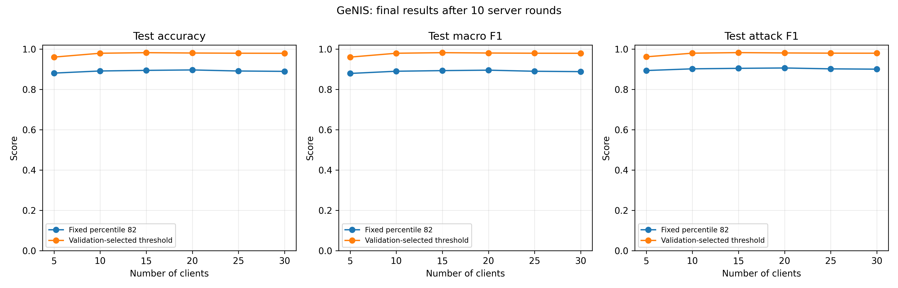

# GeNIS client-count reference measurements

Measured configuration: **70 local epochs per client per round**, 10 server rounds, previous TAAE with RNEP aggregation, latent dimension 64, batch size 16, learning rate `3e-5`, dropout 0.1 and seed 123. These are the existing recorded measurements.

The same ordered pool of **31,123 normal training rows** was partitioned using `numpy.array_split`; increasing the client count changes the partition sizes, not the total training pool. All runs share the same **7,630 validation rows** (3,815 normal and 3,815 attack) and **8,746 test rows** (4,373 normal and 4,373 attack), with the same preprocessing and frozen implementation source. The recorded source/data hashes, partition sizes and full settings are in [experiment_config.json](experiment_config.json) and [partition_summary.csv](partition_summary.csv).

The table reports the final model after round 10. Each run's percentile was selected by **validation macro F1** and then applied to the held-out test set. **Precision, Recall and F1-score refer to Anomaly (1)**; Macro F1 averages the Normal and Anomaly F1 scores. Scores are on a 0–1 scale, rounded to four decimal places.

| Clients | Selected percentile | Accuracy | Precision | Recall | F1-score | Macro F1 | ROC-AUC |
| ---: | ---: | ---: | ---: | ---: | ---: | ---: | ---: |
| 5 | 97.14 | 0.9601 | 0.9286 | 0.9968 | 0.9615 | 0.9600 | 0.9888 |
| 10 | 97.98 | 0.9792 | 0.9629 | 0.9968 | 0.9796 | 0.9792 | 0.9900 |
| **15** | 98.15 | **0.9820** | 0.9674 | 0.9977 | 0.9823 | **0.9820** | **0.9904** |
| 20 | 97.81 | 0.9803 | 0.9642 | 0.9977 | 0.9807 | 0.9803 | 0.9901 |
| 25 | 97.82 | 0.9793 | 0.9645 | 0.9952 | 0.9796 | 0.9793 | 0.9894 |
| 30 | 97.69 | 0.9790 | 0.9621 | 0.9973 | 0.9793 | 0.9790 | 0.9890 |

The [full comparison CSV](client_comparison.csv) contains both the validation-selected results above and the fixed-percentile-82 control. The figure below shows both policies; [round_comparison.png](round_comparison.png) separately shows round-by-round validation performance at the fixed percentile.

### Interpretation of the archived measurements

- **15 clients performs best in this run.** Relative to 5 clients, accuracy improves by **2.20 percentage points**. Most of the difference comes from fewer normal samples being flagged as attacks: false positives fall from **335 to 147**, and Normal recall rises from **92.34% to 96.64%**. Missed attacks also decrease from 14 to 10. Thus the gain reflects improved balance between normal acceptance and attack detection, while attack recall remains high.
- **More clients do not produce a monotonic improvement.** With 10–30 clients, accuracy stays within **97.90–98.20%**, a spread of approximately **0.31 percentage points**. Increasing the count beyond 15 gives no consistent predictive benefit in these measurements. The training pool per client decreases from 6,224–6,225 rows at 5 clients to 1,037–1,038 at 30 clients. Smaller partitions, fewer optimizer steps per client per local epoch and different RNEP pairings are possible contributors to the trend; this experiment does not isolate their individual effects.
- **Threshold calibration materially affects the comparison.** At the fixed percentile of 82, accuracy is only **88.07–89.64%** and Normal recall is **76.15–79.28%**, despite very high attack recall. The fixed-threshold control has its highest accuracy at **20 clients**, whereas validation-selected thresholds give the highest accuracy at **15 clients**. ROC-AUC is threshold-independent and also peaks at 15 clients, although the AUC differences are small. Threshold-dependent results should therefore be compared under the same selection policy.
- **The conclusion is specific to this protocol.** These are single-seed measurements with a shared shuffled-row partitioning recipe. They support 15 clients as a reference setting for this GeNIS experiment, but do not establish a universally optimal client count or a statistically significant advantage. Repeated seeds and non-IID client partitions would be needed to assess how reliably the ordering generalizes.

Per-client artifacts, confusion matrices and completion checks are under `results/clients/clients_<N>/`; see the [study README](README.md) for the directory contents.

